# Music Modeler: A piano tutoring app using a Tiered Scoring Pipeline and Teacher-Tailored Language Models for Student Feedback

**Technical Report · Summer Internship 2026, Vanderbilt University**

**Aruna Nagabhushan**<br>
**Neuqua Valley High School**, Naperville, IL

*Under the guidance of* **Dr. Aniruddha Gokhale**, **Dr. Himanshu Neema** and **Dr. Yogesh Barve**, **Vanderbilt University**

---

## Abstract

Children learning piano practice mostly alone between lessons, and mistakes
practiced without feedback become habits. This report presents Music Modeler,
a system that turns each practice recording into short, encouraging,
teacher-approved feedback. It is organized in two parts.

**Part I** describes the data-scoring pipeline and how it was improved. A
recording is transcribed to notes and cleaned of transcription artifacts. It
is then aligned with the teacher's own reference recording and scored phrase
by phrase on up to four dimensions (pitch, note order, timing and tempo,
dynamics), which a per-assignment tier switches on. Unlike practice apps that
judge each note as it is played, the pipeline evaluates the entire submission
phrase by phrase, matching notes by their longest common subsequence so the
notes on either side of a mistake still pair up; its layered tiers never
penalize a student for a tier above the one being trained. We document the
faults found and fixed, each with before-and-after evidence:
- a slow student lost up to half their notes before scoring;
- tempo was absorbed entirely, so a performance at one third speed scored
  perfectly;
- the duration measure inverted below half speed.

A mistake-injection test harness then verifies the pipeline against a
closed-form oracle over 186 generated attempts with 396 recorded mistakes.

**Part II** turns to the language models that write the feedback. Small local
models (2–3B parameters) were given the score data and a prompt written for a
young beginner. We evaluated them on five criteria, including whether *a child
would hear the feedback as encouraging and clear*, using mechanical detectors
and a blinded frontier-model judge with negative controls.

The base models wrote warmly but invented problems. In 34–58% of cases they
criticized tempo at beginner tiers where tempo is not scored, contradicting an
explicit rule. We generated reference feedback from the mistake ledger and
fine-tuned three models with QLoRA (Quantized Low-Rank Adaptation), which
trains a small set of added weights on top of a frozen, 4-bit compressed model:
- tier violations fell from 239 of 558 drafts to 3;
- tone scores reached 2.88–2.97 of 3 while factual accuracy held;
- all three models converged to within 0.26 points on a 12-point rubric.

The teacher approves every message, and every correction feeds the next round
of tuning. The design extends beyond piano to other tutoring subjects.

**Keywords:** music performance assessment, automatic piano transcription,
intelligent tutoring, feedback for children, data-to-text generation, LLM
evaluation, LLM-as-a-judge, QLoRA, mutation testing.

---

## Contents

1. Introduction
2. Literature Survey

**Part I — The Scoring Pipeline**

3. Pipeline Design
4. Improving the Pipeline
5. Verifying the Pipeline with Injected Mistakes

**Part II — Language Models for Encouraging Feedback**

6. Writing for a Child
7. Evaluating the Feedback
8. Training the Models
9. Lessons About Measuring Feedback

**Part III — System, Discussion and Outlook**

10. Tool Outline
11. Demonstrating the Toolset
12. Discussion and Limitations
13. Beyond Piano
14. Conclusion and Future Work

Acknowledgments · References

---

## 1. Introduction

A child learning piano typically sees a teacher once a week. Skill grows fastest when practice gets timely feedback on specific weaknesses.
Among pianists, *how* students practice, finding and fixing errors early,
predicts retention better than *how long* they practice [1]. Between lessons,
most of a child's practice goes unheard.

Feedback for a child has to meet two demands at once.
- **It must be right.** Feedback that is fluent but wrong is worse than none:
  a child cannot tell the difference and will practice the wrong thing.
  Feedback research shows poorly targeted feedback can lower performance [2].
- **It must be kind.** It should name one thing to work on, in plain words,
  and leave the child wanting to try again [3].

Meeting both requires a measurement pipeline accurate enough to trust, and a
writer that stays faithful to the measurements while sounding like an
encouraging teacher.

This report describes how we built both, and how we improved each through
measurement.
- **Part I (Chapters 3–5)** is the scoring pipeline: its design, the series
  of faults we found and fixed, and its verification.
- **Part II (Chapters 6–9)** is the language models: how we prompted, evaluated and
  fine-tuned small local models to write encouraging, accurate feedback. It
  also covers the framework through which the teacher approves every message
  and keeps tailoring the models.

**Contributions.**

1. **A tiered scoring pipeline for children's practice.** Cleanup is applied
   to both the student's and the teacher's transcription. Phrases come from the
   teacher's recording only, and there is no time-warping. Four tiers add
   dimensions as the child progresses, and tempo is never penalized for
   beginners.
2. **An improvement record.** Six faults in successive versions of the
   pipeline are each documented with the symptom, diagnosis, fix and measured
   effect. We also measure how transcription noise affects each score
   dimension.
3. **A child-centered evaluation of language-model feedback.** The rubric's
   tone criterion asks whether *a child would hear this as encouraging and
   clear*. Mechanical detectors check jargon and harsh wording. A blinded judge
   with negative controls separates warmth from accuracy.
4. **Training small local models for kind, accurate feedback.** References are
   generated from a mistake ledger and used to fine-tune the models with QLoRA
   (Quantized Low-Rank Adaptation). Tier violations
   fall from 239 to 3 with near-ceiling tone.
5. **A teacher tailoring framework.** Multiple models draft, the teacher
   approves, and corrections drive retraining.

### 1.1 Objectives

1. Score a student's attempt against the teacher's own reference recording,
   phrase by phrase, with strictness set per assignment.
2. Draft feedback from those scores with small language models that run
   locally, and route every draft through teacher approval.
3. Capture every teacher correction as training data.
4. Build an evaluation harness that produces exact ground truth for both the
   grader and the feedback models without waiting for real data.
5. Use the harness to measure the models' failures, fine-tune them, and
   evaluate the result with independent instruments.

### 1.2 Organization

Chapter 2 surveys the literature and existing products.
- **Part I:** Chapter 3 describes the scoring pipeline, Chapter 4 the
  improvements that shaped it, and Chapter 5 its verification with injected
  mistakes.
- **Part II:** Chapter 6 covers how the language models are prompted and kept
  under the teacher's control, Chapter 7 how their feedback is evaluated,
  Chapter 8 how they were trained, and Chapter 9 what we learned about
  measuring feedback.
- **Part III:** Chapter 10 outlines the implemented tool, and Chapter 11
  demonstrates the toolset end to end: the application screen by screen, and
  one real case through the harness. Chapter 12 discusses results and
  limitations, Chapter 13 looks beyond piano, and Chapter 14 concludes.

---

## 2. Literature Survey

**Transcription.** Modern piano transcription regresses note onsets and
offsets directly from audio [4]. Lightweight instrument-agnostic models trade
accuracy for size [5].

**Alignment.** Dynamic time warping [6] is the standard way to align a
performance with a reference, and error-aware symbolic aligners detect
insertions and deletions explicitly [7]. Longest common subsequence (LCS) [8]
finds the longest run of notes two sequences share in order, the simplest
form of global alignment; local alignment [9] instead finds matching
sub-regions.

**Error detection and assessment.** Score-informed transcription detects
missing and extra notes for piano tutoring [10, 11]. Assessment research mostly
regresses recordings onto expert ratings [12]. LLaQo pairs an audio encoder with an
LLM to answer teachers' questions about a performance [13].

**Practice apps.**
- Consumer apps such as Yousician, Simply Piano and Skoove [14–16] correct
  notes in real time, but do not explain what to practice or involve the
  teacher.
- Teacher platforms such as SmartMusic, Piano Marvel and MatchMySound [17–19]
  score recordings and leave the words to the teacher [20].
- None drafts feedback for a teacher to approve.

**Text from data, and its evaluation.**
- *Faithfulness:* turning structured data into text risks fluent output that
  misstates the data [21].
- *Edit cost:* post-editing effort is measured by edit rate [22].
- *LLM judges:* they are widely used [23] but have known biases, including a
  preference for output from their own model family [24].
- *Fine-tuning:* **LoRA** (Low-Rank Adaptation) [25] freezes a pre-trained
  model's weights and trains only a small pair of low-rank matrices added to
  selected layers. The update is a fraction of a percent of the model's size,
  so training is fast and needs far less memory than full fine-tuning.
  **QLoRA** (Quantized LoRA) [26] goes further: the frozen base model is held
  in 4-bit precision, and gradients flow through it into the LoRA matrices.
  Together they make it possible to fine-tune a multi-billion-parameter model
  on a single consumer GPU.
- *Repetition:* maximum-likelihood models decoded near-greedily tend toward
  repetitive output [27].

---

# Part I — The Scoring Pipeline

## 3. Pipeline Design

### 3.1 Design principles

Three principles shape the system. Each answers a need set out in Chapter 1 and is
grounded in the survey.

1. **Scores, not a rating.** The grader returns a per-phrase, per-dimension
   score vector and never a composite (§2). Every sentence of feedback can
   then be checked against a specific number, which turns feedback generation
   into a constrained data-to-text task (§2).
2. **Strictness grows with the student.** Four tiers each switch on one more
   dimension. Tempo is not scored at tiers 1–2, because slow, accurate practice
   is correct for a beginner (§1).
3. **The teacher stays in the loop.** The student only sees text the teacher
   approved. The teacher's edits are recorded as training data, so the drafts
   move toward that teacher's standards over time.

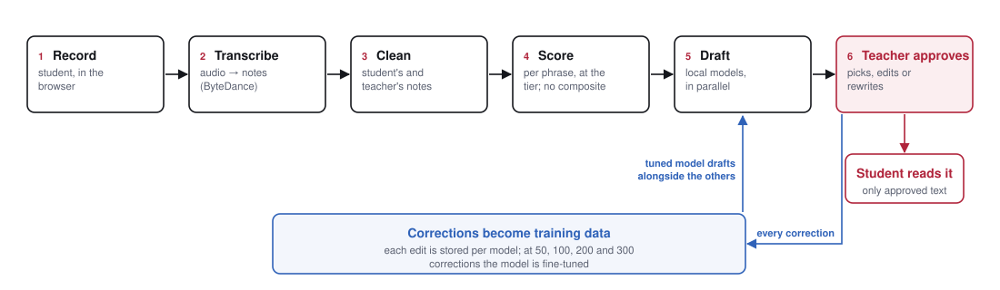

*Figure 1. The feedback loop. A recording is transcribed, cleaned on both
sides and scored per phrase at the tier; local models draft feedback; the
teacher approves or edits it before the student reads it. Every correction is
stored as training data, and the fine-tuned model then drafts alongside the
others.*

### 3.2 Tiered scoring against the teacher's reference

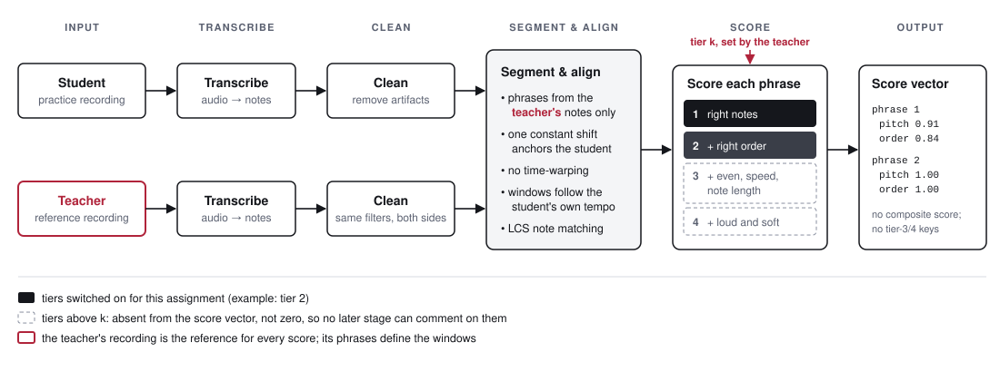

*Figure 2. The scoring pipeline. The student's and the teacher's recordings are
transcribed and cleaned with the same filters. Phrases come from the teacher's
notes only; the student is anchored by one constant shift, with windows that
follow the student's own tempo, and notes are matched without time-warping.
Each phrase is scored at the tier the teacher set. Dimensions above that tier
are absent from the score vector, so no later stage can comment on them.*

**Transcription.** Audio is transcribed with the high-resolution piano model
of Kong et al. [4]. It was chosen over Basic Pitch [5] by direct comparison on
the system's material: note F1 0.930 against 0.524, and Basic Pitch scored zero
on notes shorter than 0.5 s.

**Cleanup on both files.** The teacher's reference is as likely to contain
transcription artifacts as the student's recording. Scoring a clean student
against a noisy reference creates errors that look like the student's fault.
Cleanup therefore runs on both files (Algorithm 2).

**Phrases from the teacher only.** Phrase boundaries are detected on the
teacher's file at rests of 0.4 s or more. If the student's file were also
segmented, the student's timing errors would move the boundaries and the two
performances would no longer be comparable. Windows are projected into the
student's timeline with a tolerance, and the student's timestamps are never
rewritten.

**No warping.** A single constant time shift anchors the student to the
teacher. Dynamic time warping is deliberately not used (§2): for a beginner,
slow tempo is a quantity to measure, not a difference to remove.

**Tiers.**

| Tier | Adds | Measure |
|---|---|---|
| 1 | pitch | bag-of-notes F1 per phrase (order-independent) |
| 2 | order | exact-pitch longest common subsequence ÷ teacher's notes |
| 3 | timing, tempo, duration | a straight-line fit `student_onset ≈ ratio × teacher_onset + offset` over matched notes: timing = share within ±0.75 s of the line; tempo score from the ratio (full credit within 1.25×, zero at 2.5×) with a slow/fast flag; duration = share whose length ratio, **divided by the tempo ratio**, lies in 0.5–2 |
| 4 | dynamics | share of matched notes within ±40 MIDI velocity |

Dividing duration by the fitted tempo ratio makes it measure articulation rather
than speed. A student at half speed correctly holds every note twice as long.
Without this normalization the duration signal inverts below half speed.

**Notation.** Each algorithm is given twice: first in plain English, then in a
compact mathematical form ("b") with the same line numbers. The compact forms
use these names:

| Name | Meaning |
|---|---|
| `note = (pitch, onset, length, velocity)` | one note |
| `T`, `S` | the teacher's and the student's notes |
| `tier` | the assignment's tier, 1 to 4 |
| `phrases` | the phrase windows; `S in phrase` is the student's notes in one window |
| `score` | a score vector, for example `score.pitch`, `score.order` |
| `ratio`, `offset` | the fitted tempo ratio and time offset |
| `ledger`, `entry` | the record of injected mistakes, and one mistake in it |

### 3.3 Grading algorithms

**Algorithm 1 — `Grade(teacher_notes, student_notes, tier)`**: the whole attempt

```
1: clean the teacher's notes and the student's notes          (Algorithm 2)
2: split the teacher's notes into phrases at rests of 0.4 s or more
3: shift the student's notes so the two first notes line up   (no warping)
4: for each phrase:
5:     score the phrase at the tier                            (Algorithm 3)
6: return the mean of the rounded phrase scores
```

**Algorithm 1b — `Grade(T, S, tier)`, compact form**

```
Require: teacher notes T, student notes S, tier          Ensure: score
1:  T ← Clean(T) ;  S ← Clean(S)
2:  phrases ← Segment(T, rest = 0.4 s)                     ▷ from the teacher only
3:  S ← Anchor(S, T)                                       ▷ one constant shift
4:  for each phrase in phrases do
5:      score[phrase] ← ScorePhrase(T in phrase, S in phrase, tier)
6:  return Rollup(score)                                   ▷ mean of rounded phrase values
```

**Algorithm 2 — `Clean(notes)`**: removes transcription artifacts, not playing errors

```
1: shorten notes whose release was never detected
2: drop overtones: a quieter note an octave, a twelfth or a higher partial
   (within one semitone) above a louder note that starts within 0.05 s
3: drop blips: weak, short notes beside a stronger one
4: fuse same-pitch fragments separated by less than 0.15 s
5: keep only notes with velocity 20 or more and length 0.03 s or more
```

**Algorithm 2b — `Clean(N)`, compact form**

```
1:  N ← CapRunaway(N)
2:  N ← DropOvertones(N, window = 0.05 s, intervals = {12, 19, 24, 28, 31, 36} ± 1)
3:  N ← DropBlips(N)
4:  N ← Fuse(N, gap = 0.15 s)
5:  return { n ∈ N : n.velocity ≥ 20 and n.length ≥ 0.03 s }
```

**Algorithm 3 — `ScorePhrase(teacher_notes, student_notes, tier)`**

```
 1: matched = number of pitches the two phrases have in common
              (each pitch counted as often as it occurs in both)
 2: scores.pitch = 2 × matched / (teacher note count + student note count)
 3: if tier ≥ 2:
 4:     pairs = longest common subsequence of the two pitch sequences
 5:     scores.order = number of pairs / teacher note count
 6: if tier ≥ 3 and number of pairs ≥ 2:
 7:     fit the line  student_onset = tempo_ratio × teacher_onset + offset
        over the matched pairs
 8:     scores.timing = share of pairs within 0.75 s of that line
                                                   # did they play evenly?
 9:     scores.tempo, scores.tempo_flag = TempoScore(tempo_ratio)
                                                   # was the speed right?
10:     scores.duration = share of pairs where
          0.5 ≤ student_length / (tempo_ratio × teacher_length) ≤ 2
                                                   # held right for that speed?
11: if tier = 4:
12:     scores.dynamics = share of pairs whose loudness differs by 40 or less
13: return scores
```

**Algorithm 3b — `ScorePhrase(T, S, tier)`, compact form**

The same algorithm in mathematical notation. `T` and `S` are the teacher's and
the student's notes in one phrase; each note has a `pitch`, `onset`, `length`
and `velocity`. `P` is the set of matched note pairs, and `score` is the
phrase's score vector.

```
1:  M ← |bag(T.pitch) ∩ bag(S.pitch)| ;  score.pitch ← 2M / (|T| + |S|)
2:  if tier ≥ 2:  P ← LCS(T, S) ;  score.order ← |P| / |T|
3:  if tier ≥ 3 ∧ |P| ≥ 2:
4:      ratio, offset ← LinearFit(T.onset, S.onset over P)
5:      score.timing   ← |{ p ∈ P : |S.onset − (ratio · T.onset + offset)| ≤ 0.75 s }| / |P|
6:      score.tempo, score.tempo_flag ← TempoScore(ratio)
7:      score.duration ← |{ p ∈ P : 0.5 ≤ S.length / (ratio · T.length) ≤ 2 }| / |P|
8:  if tier = 4:
9:      score.dynamics ← |{ p ∈ P : |S.velocity − T.velocity| ≤ 40 }| / |P|
10: return score
```

Line 7 is the tempo normalization of §4.6: dividing by `ratio` makes duration
measure articulation rather than speed.

Within tier 3 each key answers one question. *Timing* asks whether the student
played evenly, *tempo* whether the speed was right, and *duration* whether
notes were held correctly for the speed chosen. A student can play perfectly
evenly at completely the wrong speed, and timing alone would never show it.

The roll-up is a mean of *rounded* per-phrase values. For phrases of 4 and 8
notes with 2 dropped from the first, the true global recall is 0.833 but the
roll-up gives mean(0.5, 1.0) = 0.75. The oracle must reproduce exactly this
behavior.

---

## 4. Improving the Pipeline

The pipeline reached its current form through a series of measured fixes. We
report each as symptom, diagnosis, fix and evidence. Most were found by
constructing performances whose correct score was known, the approach the
evaluation harness (Chapter 5) later made systematic.

### 4.1 Choosing a transcriber

Two transcribers were compared on the same reference material:

| Metric | Kong et al. [4] | Basic Pitch [5] |
|---|---|---|
| Overall note F1 | **0.930** | 0.524 |
| Short notes (< 0.15 s) F1 | **1.000** | 0.000 |
| Medium notes (0.15–0.5 s) F1 | **1.000** | 0.000 |

Beginner pieces consist almost entirely of short and medium notes, which rules
out the lighter model.

### 4.2 Classifying misalignment

A student's attempt can differ from the teacher's in seven ways:
1. a different starting time;
2. extra notes;
3. missing notes;
4. stretched notes;
5. compressed notes;
6. wrong rests between notes;
7. any combination of the above.

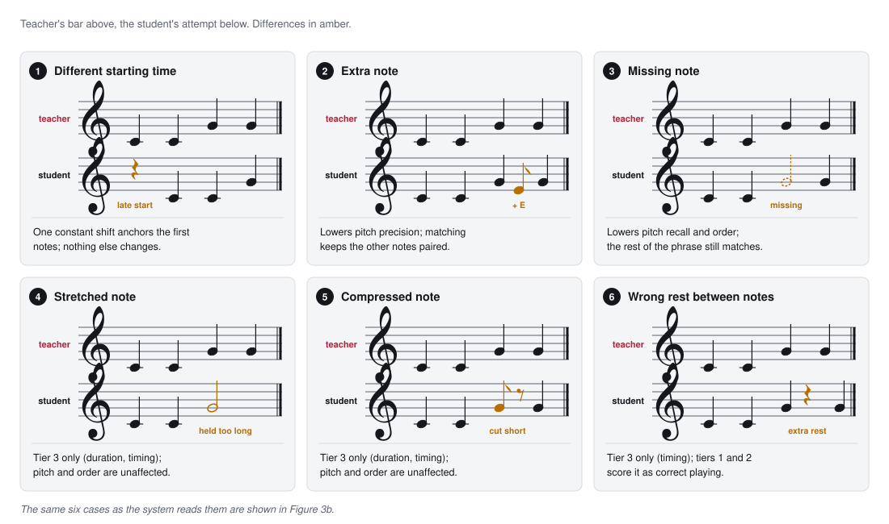

*Figure 3a. Six kinds of misalignment, as a musician would write them. In each
panel the teacher's bar sits above the student's attempt, with the difference
in amber: a late start, an extra note, a missing note, a note held too long, a
note cut short, and an extra rest.*

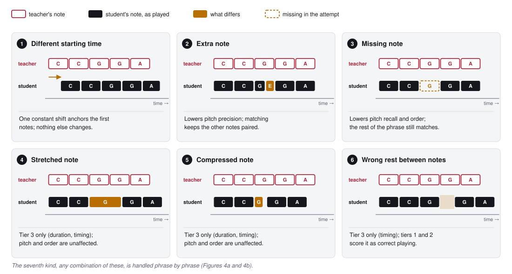

*Figure 3b. The same six kinds of misalignment, as the system reads them. In each panel the teacher's notes
(outlined) sit above the student's attempt (filled); the difference is in
amber. The text under each panel says how the pipeline responds. Only a
different starting time is corrected; every other difference is measured, and
only by the tier responsible for it.*

The pipeline handles these as follows:
- **Starting time (1)** is absorbed by anchoring the first notes.
- **Extra and missing notes (2–3)** reduce pitch precision and recall, and
  longest-common-subsequence matching keeps them from disturbing the rest of
  the phrase.
- **Stretched, compressed and wrongly timed notes (4–6)** affect only the
  tier-3 measures. A student whose only issue is timing still scores well on
  pitch and order.
- **Errors never cascade.** Because alignment restarts at each phrase, a
  misalignment in one phrase does not spill into the next.

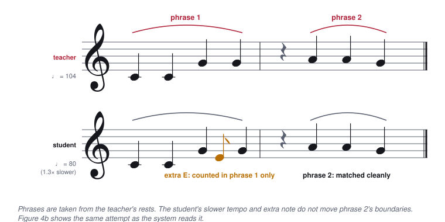

*Figure 4a. Two phrases, as a musician would write them. Slurs mark the
teacher's two phrases, separated by a rest. The student plays more slowly
(♩ = 80 against 104) and adds an extra E in phrase 1; phrase 2 is unchanged.*

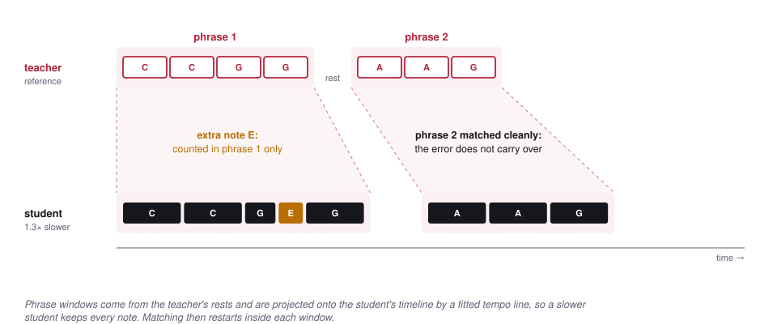

*Figure 4b. The same attempt, as the system reads it: errors do not cascade. The teacher's rest splits the piece into two
phrases. The student plays 1.3× slower and adds an extra E in phrase 1. The
teacher's phrase windows are projected onto the student's timeline by a fitted
tempo line, so the slower student keeps every note, the extra note counts
against phrase 1 only, and phrase 2 is matched cleanly.*

Smith–Waterman local alignment [9] was tried and rejected: it fragments on
repeated notes, which are common in beginner pieces (for example C C G G A A G).
DTW [6] was rejected because it removes tempo differences, and a child's tempo
is something to measure, not to erase.

### 4.3 Cleaning both recordings

**Symptom.** Clean student performances scored below 1.0 against a clean
teacher.

**Diagnosis.** The teacher's own transcription carried overtones and
fragments, which the student was then penalized for not reproducing.

**Fix.** The same cleanup runs on both recordings.

### 4.4 Slow students silently lost notes

**Symptom.** Slower students were told they had skipped half the piece.

**Diagnosis.** Student notes were filtered against the teacher's phrase
windows widened by a flat ±20%. A slower student drifts steadily later, so
their closing notes fell outside every window and were *discarded before
scoring*: not matched, not counted as extra, simply gone. Because the drift
accumulates, each phrase lost more than the last. The timing score still read
1.0, because it only saw the notes that survived.

**Fix.**
- The teacher's phrase windows are projected onto the student's timeline by an
  affine fit `t_S ≈ slope · t_T + intercept`. The fit is a regression over
  whole-piece matches, with fallbacks when too few notes match, and is trusted
  only for slopes between 0.2 and 5.
- Only the windows move; note timestamps are never rewritten.
- Every note is assigned to exactly one phrase. Previously, notes in
  overlapping windows were counted twice.

| Student speed | Notes kept, before | after | Pitch F1, before | after |
|---|---|---|---|---|
| 0.80× | 8/8 | 8/8 | 1.00 | 1.00 |
| 0.67× | 7/8 | **8/8** | 0.933 | **1.00** |
| 0.50× | 5/8 | **8/8** | 0.769 | **1.00** |
| 0.33× | 4/8 | **8/8** | 0.667 | **1.00** |

On a two-phrase piece at half speed the effect had been worse: 4 of 8 notes
lost, and pitch F1 0.428.

### 4.5 Tempo was absorbed completely

**Symptom.** Once note loss was fixed, a student playing at a third of the
teacher's speed with every note right scored 1.0 everywhere. The earlier note
loss had been acting as an accidental slowness detector.

**Diagnosis.** The timing score measures *evenness* against a fitted line, so
a steady but slow performance is perfectly even. A tempo flag was referenced in
the feedback prompt, but the grader never produced it.

**Fix.** Two tier-3 measures were added:
- **A tempo score.** Full credit within 1.25× of the teacher's tempo, falling
  to zero at 2.5×, measured in log space so that twice too slow and twice too
  fast are penalized equally.
- **A tempo flag.** "Very slow" at a ratio of 2.5 or more, "very fast" at 0.4
  or less.

The same slow performance now scores differently by tier, which is the
intended design:

| Tier | Same performance at 3× slower |
|---|---|
| 1 | pitch 1.0, no tempo keys present |
| 2 | + order 1.0, no tempo keys present |
| 3 | + timing 1.0, duration 1.0, **tempo 0.0, flag "very slow"** |
| 4 | as tier 3, plus dynamics |

While writing this fix we also found that the documented direction of the
tempo ratio was inverted. Implemented literally, it would have labeled a
student playing 2.5× *too fast* as very slow.

### 4.6 The duration measure inverted below half speed

**Symptom.** Duration scores collapsed exactly at 2× slower, with no flag to
explain it.

**Diagnosis.** At half speed, a student correctly holds every note twice as
long. The raw duration comparison punished tempo a second time, and below half
speed its signal inverted:

| Student at 3× slow | Before | After |
|---|---|---|
| Note lengths scaled with the tempo (musically correct) | 0.00 | **1.00** |
| Original short lengths, becoming detached (musically wrong) | 1.00 | **0.00** |

**Fix.** Each duration ratio is divided by the fitted tempo ratio. Each tier-3
measure now answers exactly one question:
- *Timing:* did the student play evenly?
- *Tempo:* was the speed right?
- *Duration:* were the notes held the right length for the speed chosen?

### 4.7 Lenient scoring for young learners

An earlier strict scorer used continuous penalties for timing (deviation within
0.25 s), duration and dynamics. The current scorer uses lenient,
binary-tolerance measures: timing within 0.75 s, duration ratio 0.5–2×, and
velocity within 40. Combined with the tier rules, a beginner at half speed is
penalized neither on timing (the fitted line absorbs steady drift) nor on pitch
(no note is lost). Tempo is not scored at their tier at all. Strictness enters
only when the teacher raises the tier.

### 4.8 How transcription noise affects each dimension

The same performances were scored twice: once from their MIDI directly, and
once from audio through the transcriber.

| Score | Mean change, audio vs MIDI | Assessment |
|---|---|---|
| Pitch | −0.06 | reliable |
| Order | −0.05 | most stable |
| Timing | −0.07 mean, −0.51 worst | unreliable on fast repeated notes |
| Duration | −0.04 | same caveat as timing |
| Dynamics | −0.19, systematic | unreliable on synthesized audio |

The worst timing case was "Twinkle Twinkle": the transcriber blurs onsets of
short, repeated same-pitch notes. This is one more reason the timing measure
is lenient and only switches on at tier 3.

---

## 5. Verifying the Pipeline with Injected Mistakes

### 5.1 The harness

The harness applies mutation testing [28] to the scoring pipeline, which sidesteps
the test-oracle problem [29]. It takes
a correct performance, breaks it in known ways, records each break in a
**ledger**, and checks that the grader reports what was broken. Four rules make
the ledger trustworthy.

1. **The real grader, pinned.** The harness imports the grader from the
   application rather than copying it, and pins its SHA-256 hash. Results are
   therefore always about the code that serves students, and a changed grader
   is detectable.
2. **The cleanup fixed point.** An injected mistake that the grader's own
   cleanup would erase cannot be detected, so recording it would make the
   ledger describe audio that does not exist. Examples are an inserted note
   that looks like an overtone, or a repeat that gets fused. The harness
   requires `Clean(S) = S` and `Clean(T) = T`, and re-draws until both hold.
   This is the harness's filter for equivalent mutants.
3. **Tutor-origin selection.** Operations act only on notes from the original,
   so a later mistake cannot cancel an earlier one. An example would be dropping
   a note that an earlier insert had added.
4. **An independent oracle.** Expected tier-1 scores are computed in closed
   form from the ledger without grader code, so a grader fault cannot confirm
   itself (Algorithms 5–6).

**The simulated cohort.** Six students with different starting severity,
learning rate and tier ceiling work through a 40-piece catalog: 8 pieces
written by hand (two per tier) and 32 generated. They retry, clear exercises
and advance tiers. Generation and grading are fused into a single loop, because
whether attempt *j + 1* exists depends on the real grader's verdict on attempt
*j* (Algorithm 7).

**Reference feedback with claims.** For each case, the harness writes a
reference message from the ledger and the scores, together with a
machine-readable list of the claims it makes (Algorithms 9–10). A
tier-dependent sentence appears only when its score key is *present*. The
steady-tempo compliment is emitted in only 60% of eligible cases, so a model
cannot learn to give it unconditionally.

### 5.2 Mistake injection

**Algorithm 4 — `Inject(teacher_notes, severity, tier)`**

```
1: for attempt = 1 to 20:
2:     student_notes = copy of teacher_notes ;  ledger = empty
3:     repeat 1 to 3 times (more often at higher severity):
4:         mistake = choose a mistake type allowed at this tier,
           weighted by the student's error profile
5:         note = choose a note of student_notes that came from teacher_notes
                                                   # never a note we added
6:         apply the mistake to that note, scaled by severity,
           and write an entry to the ledger
7:     if Clean(student_notes) = student_notes
          and Clean(teacher_notes) = teacher_notes:
8:         return student_notes, ledger            # the cleanup fixed point
9: quarantine the case and report it
```

**Algorithm 4b — `Inject(T, severity, tier)`, compact form**

The same algorithm in mathematical notation. `T` is the teacher's note list,
`S` the student's, and `ledger` the record of injected mistakes. `Mistakes[k]`
is the set of mistake types allowed at tier `k`:

```
Mistakes[1] = { insert, drop, wrong_pitch }
Mistakes[2] = Mistakes[1] ∪ { swap_order }
Mistakes[3] = Mistakes[2] ∪ { hesitate, scale_tempo, scale_duration }
Mistakes[4] = Mistakes[3] ∪ { change_velocity }
```

```
1: for attempt = 1 to 20:
2:     S ← copy(T) ;  ledger ← ∅
3:     for j = 1 to count(severity),  count(severity) ∈ {1, 2, 3}:
4:         mistake ← Draw(Mistakes[tier])
5:         n ← Draw({ x ∈ S : x.origin = teacher })
6:         (S, entry) ← mistake(S, n, severity) ;  ledger ← ledger ∪ { entry }
7:     if Clean(S) = S ∧ Clean(T) = T:
8:         return (S, ledger)
9: Quarantine(case)
```

`wrong_pitch` avoids the grader's overtone intervals, read live from the grader,
so its own cleanup cannot erase the substituted note. Timing operations never
move the first note, which anchors the alignment.

### 5.3 The oracle

**Algorithm 5 — `Verify(ledger, score)`**: checks the grader against the ledger, using no grader code

```
1: if the student's note count in each phrase is not what the ledger implies:
       report a generator fault
2: compute the expected tier-1 scores from the ledger alone      (Algorithm 6)
3: if the grader's pitch scores differ, per phrase or rolled up: report a grader fault
4: if the tier is 2 or above:
5:     for each mistake in the ledger that should be detectable:
6:         if none of the dimensions it affects fell below 1: report a grader fault
7: if the ledger is empty but any dimension is below 1: report a grader fault
8: otherwise: pass
```

**Algorithm 5b — `Verify(ledger, score)`, compact form**

```
Require: ledger, observed score          Ensure: Pass, GraderFault or GeneratorFault
1:  if NoteCounts(S, phrases) ≠ NoteCounts(ledger) then return GeneratorFault
2:  expected ← ExpectedFromLedger(ledger)                    ▷ exact for tier 1
3:  if score.pitch ≠ expected.pitch (per phrase and rolled up) then return GraderFault
4:  if tier ≥ 2 then
5:      for each entry in ledger with entry.detectable do
6:          if min(score[d] for d in entry.affects) = 1 then return GraderFault
7:  if ledger = ∅ and min(score) < 1 then return GraderFault  ▷ clean-case control
8:  return Pass
```

**Algorithm 6 — `ExpectedFromLedger(ledger)`**: the closed-form prediction, with no grader code

```
1: expected student notes = teacher notes + inserted notes − dropped notes
2: expected matching pitches = teacher notes − dropped notes − wrong pitches
3: for each phrase:
4:     precision = matching pitches ÷ student notes in the phrase;
       recall = matching pitches ÷ teacher notes in the phrase
5:     phrase pitch score = F1 of precision and recall, rounded to 3 decimals
6: return the mean of the rounded phrase scores, rounded to 3 decimals
```

**Algorithm 6b — `ExpectedFromLedger(ledger)`, compact form**

```
1:  student_count ← |T| + count(ledger, insert) − count(ledger, drop)
2:  matched ← |T| − count(ledger, drop) − count(ledger, wrong_pitch)
3:  for each phrase in phrases do
4:      precision ← matched[phrase] / student_count[phrase] ;  recall ← matched[phrase] / |T in phrase|
5:      expected[phrase] ← round(2 · precision · recall / (precision + recall), 3)
6:  return round(mean(expected), 3)                ▷ mean of rounded values, as the grader does
```

The oracle is exact for tier 1. For tiers 2–4, lines 4–6 are a weaker check
that the affected dimension moved. An exact second layer for those tiers is
designed but not yet implemented (§12.3).

### 5.4 Simulating the cohort

**Algorithm 7 — `RunCohort(students, catalog)`**: the simulated class

```
each simulated student has a starting severity, a learning rate and a highest tier
1: for each student:
2:     start at tier 1, with no attempts yet
3:     for each exercise at the current tier, while below the student's highest tier:
4:         repeat:
5:             count one more attempt
6:             set the severity: the starting severity, reduced by the learning
               rate for each earlier attempt, with a little noise, never below 0.04
7:             inject mistakes at that severity                     (Algorithm 4)
8:             grade the attempt with the real grader               (Algorithm 1)
9:             check the scores against the ledger                  (Algorithm 5)
10:            record the case
11:        until the attempt passes, or three attempts have been made
12:        if the student has cleared the tier: move up one tier
```

**Algorithm 7b — `RunCohort(students, catalog)`, compact form**

```
Require: students (each with start_severity, learning_rate, max_tier), catalog
1:  for each student s do
2:      tier ← 1 ;  attempt ← 0
3:      for each exercise e in catalog[tier] while tier ≤ s.max_tier do
4:          repeat
5:              attempt ← attempt + 1
6:              severity ← max(s.start_severity · (1 − s.learning_rate)^(attempt − 1) · (1 + noise), 0.04)
7:              (S, ledger) ← Inject(e.teacher_notes, severity, tier)
8:              score ← Grade(e.teacher_notes, S, tier)    ▷ the real grader
9:              Verify(ledger, score)
10:             emit case (s, e, attempt, ledger, score)
11:         until Passed(score, tier) or attempts(e) = 3
12:         if Cleared(s, tier) then tier ← tier + 1
```

Line 8 is why generation and grading cannot run as two separate passes. The
loop condition on line 11 depends on the real grader's verdict, so attempt
*j + 1* does not exist until attempt *j* has been graded.

### 5.5 Results

The canonical run produced 186 cases across six students, 40 exercises and four
tiers (56, 62, 43 and 25 cases per tier), with 396 injected mistakes:

| Operation | Count |
|---|---|
| insert | 92 |
| swap order | 89 |
| drop | 86 |
| wrong pitch | 79 |
| scale duration | 19 |
| hesitate | 17 |
| change velocity | 14 |

Each case has 1–3 mistakes, at severities from 0.10 to 0.89 (mean 0.51).

| Student | Exercises | Attempts | Retries | Final tier |
|---|---|---|---|---|
| A | 31 | 32 | 1 | 4 |
| B | 30 | 39 | 9 | 3 |
| C | 21 | 26 | 5 | 4 |
| D | 21 | 25 | 4 | 3 |
| E | 20 | 36 | 16 | 2 |
| F | 20 | 28 | 8 | 2 |
| **Total** | | **186** | **43** | |

**Verification.**
- All 3,347 oracle assertions passed.
- The cleanup fixed point re-drew 45 draws, and no case was quarantined.
- The harness characterized one defect: a tier-3 phrase whose matched notes
  share a single onset (a chord-only phrase) breaks the tempo fit. It is pinned
  by a regression test; the fix is the distinct-onset guard the grader already
  applies elsewhere.

The same 186 cases, with their ledgers and scores, become the training and
test data for Part II.

---

# Part II — Language Models for Encouraging Feedback

## 6. Writing for a Child

### 6.1 The prompt

Several small local models (qwen2.5 3B, llama3.2 3B, gemma2 2B [30–32]) each
receive the score vector, with internal fields removed, and a system prompt
written for a young beginner. The prompt sets out:
- **Form:** one sentence per phrase and a one- or two-sentence summary, never
  more than 60 words.
- **Language:** plain, warm and encouraging, with no music-theory jargon and no
  score numbers.
- **Content:** name the weakest phrase, say what to try next, and only mention
  dimensions present in the scores.
- **Wording:** vary it between students and between attempts, changing the
  phrasing but never the facts.
- **Output:** only the message the child will read, with no preamble.

**Rule 1** concerns tempo and comes first:

> If `tempo_flag` is absent, null, or missing, the student's speed was FINE. Do
> not say they played slowly. Do not say they rushed. Do not tell them to speed
> up, slow down, or use a metronome. … When `student_level` is 1 or 2, tempo is
> never scored … Working through a piece slowly is how beginners learn; never
> treat it as a mistake.

The full prompt, exactly as it is served to every model (it is also kept in
the application's `docs/05_llm_feedback.md`):

```
You are a piano tutor giving feedback to a young beginner student.

You will receive JSON scoring data from their piano performance.
The data includes tier_scores (active tiers only), phrase_breakdown (per-phrase scores),
notes_expected, and notes_played.

Score ranges:  0.0-0.4 needs significant work  |  0.4-0.6 developing
               0.6-0.8 good  |  0.8-1.0 strong

RULE 1 — TEMPO. Look at tier_scores.tempo_flag before writing anything.
  - If it is "very_slow", your feedback MUST tell the student they are playing
    far too slowly and give them one concrete way to speed up.
  - If it is "very_fast", your feedback MUST tell them they are rushing.
  - Do this even when timing_score is 1.0. timing_score only measures whether
    they played evenly; it says nothing about whether the speed was right.
  - If tempo_flag is absent, null, or missing from tier_scores, the student's
    speed was FINE. Do not say they played slowly. Do not say they rushed. Do
    not tell them to speed up, slow down, or use a metronome. You have no
    information about their speed — inventing a speed problem is the worst
    mistake you can make here.
  - When student_level is 1 or 2, tempo is never scored and tempo_flag is never
    present, so the rule above always applies. Working through a piece slowly is
    how beginners learn; never treat it as a mistake.

Other rules — follow these exactly:
- Write ONE sentence per phrase in phrase_breakdown.
- Write ONE or TWO sentences as an overall summary at the end.
- Never write more than 60 words total.
- Only mention tiers listed in tier_scores. Never mention timing or dynamics if not scored.
- If one phrase scored much lower than others, name it (e.g. "the second section").
- Use plain, warm, encouraging language. No music theory jargon. No score numbers.
- Be specific — say what went wrong and what to try next.
- Vary your wording. Two students with similar scores should not get the same
  sentences, and the same student should not read the same opening twice in a
  row. Say it in your own words each time — change the phrasing, never the
  facts. Everything you claim must still come from the scores.
- Output only the feedback the student will read. No preamble, no headings, no
  notes about these rules.
```

### 6.2 How the prompt evolved

Each prompt rule was added in response to an observed failure:

| Observation | Change |
|---|---|
| Models could not write 3–5 sentences per phrase without padding | one sentence per phrase |
| Feedback ran long, and children skimmed it | 60-word cap |
| "Your pitch F1 was 0.45" confused students | no score numbers |
| Models read "timing 1.0" as "tempo was fine" | tempo flag stated as Rule 1, "even when timing is 1.0" |
| Outputs began "Here's my feedback:" or ended with notes about the rules | output only the student-facing message |
| Different students received identical sentences | "vary your wording; change the phrasing, never the facts" |

### 6.3 What prompting could and could not fix

Three trials per model per case, across the three models:

| Case | Tempo flag | Responded correctly |
|---|---|---|
| Slow, tier 4 | very slow | 9/9 |
| Rushed, tier 4 | very fast | 8/9 |
| Slow, tier 2 | absent | **5/9** |
| Correct tempo, tier 4 | absent | **3/9** |

When the flag was set, the models acted on it reliably (17/18). The weakness
was the reverse: when there was nothing to say about speed, the models
volunteered speed advice anyway ("try a metronome", "play a bit faster")
about half the time. Further prompt wording did not move this. It is a
limitation of 2–3B models, which calls for training rather than instruction.

### 6.4 The teacher stays in the loop

No draft reaches a child directly. The teacher sees every model's draft beside
the scores, selects one and edits it, or writes their own, then approves it.
For each model the system stores the score vector, the draft, the teacher's
final text and the edit distance between them. That record is at once a
training example, a preference judgment and a measure of the teacher's effort.

A model registry tracks each model's corrections, mean edit distance and mean
output length. Retraining is triggered at 50, 100, 200 and 300 corrections, or
on the teacher's request. A tuned model is registered *alongside* the existing
models, so the teacher's ordinary reviewing becomes the comparison, and the
teacher retires whichever loses. Generated training data is kept out of the
counts that drive retraining and ranking.

**Algorithm 8 — `Feedback(submission)`**: one submission through the loop

```
1: transcribe the recording and grade it at the exercise's tier   (background task)
2: ask every active model for a draft from the scores, in parallel
3: show the drafts to the teacher, the model needing least past editing first
4: the teacher picks a draft and edits it, or writes their own
5: for each model:
6:     measure how much the teacher changed its draft (edit distance)
7:     store the scores, the final text and that distance as a training example
8:     update the model's average edit distance
9: release the final text to the student; never the scores or the drafts
```

**Algorithm 8b — `Feedback(u)`, compact form**

```
Require: submission u, active models M, system prompt
1:  score ← Grade(u.teacher_notes, Transcribe(u.audio), u.tier)
2:  drafts ← { m(prompt, score) : m ∈ M }                   ▷ in parallel
3:  show drafts ordered by mean_edit[m]
4:  final ← the teacher's chosen and edited draft, or their own text
5:  for each m in M do
6:      edit[m] ← EditDistance(drafts[m], final)
7:      store (score, final, edit[m]) as a training example for m
8:      mean_edit[m] ← update(mean_edit[m], edit[m])
9:  release final to the student
```

---

## 7. Evaluating the Feedback

### 7.1 Five criteria, one of them about the child

Every output is scored 0–3 on five criteria:

| Criterion | Question |
|---|---|
| Factual accuracy | Does every claim match the scores? |
| Tier awareness | Does it stay silent about dimensions not scored at this level, and mention a raised tempo flag? |
| Phrase specificity | Does it name the phrase that needs work? |
| **Student tone** | ***Would a child hear this as encouraging and clear?*** |
| Conciseness | Is it the right length: neither padded nor too thin to use? |

The tone anchors run:
- **0** — harsh, or full of jargon a beginner would not follow;
- **1** — flat or clinical; technically fine but discouraging;
- **2** — friendly, with a stiff phrase or two;
- **3** — warm, plain and encouraging throughout.

### 7.2 Two instruments

**Mechanical detectors** run on every output at no cost. They check:
- tier violations, by the sentiment of each clause about each dimension:
  criticizing an unscored dimension is a violation, praising it is allowed;
- phrase claims against the per-phrase pitch score;
- phrase references;
- length, with a floor;
- jargon (for example "F1", "precision", "tier", "score") and harsh words
  (for example "bad", "sloppy", "careless").

Warmth itself cannot be detected mechanically.

**A blinded frontier-model judge** scores all five criteria on a stratified
sample of 135 rows. Two kinds of row are included to keep the judge honest:
- **Reference feedback, as a blind contestant.** If the reference were shown
  as an answer key, copying it would be the easiest way to score well.
- **Mismatched controls.** A real reference attached to the *wrong* case. It
  is fluent and warm, but describes a performance that did not happen.

The judge's full instructions restate the rubric's anchors and the tempo rules,
and contain no reference answer. They are reproduced in the harness's
`docs/06_prompts.md`, together with the prompt used when local models act as
judges.

### 7.3 Initial screening

Before fine-tuning, four base models were screened on 18 cases:

| Model | Total /15 | Factual | Tier | Phrase | **Tone** | Concise |
|---|---|---|---|---|---|---|
| llama3.2 3B | 11.06 | 2.28 | 2.44 | 2.28 | **2.17** | 1.89 |
| qwen2.5 3B | 10.60 | 2.44 | 2.33 | 2.11 | **1.78** | 1.94 |
| gemma2 2B | 10.06 | 2.17 | 2.17 | 1.67 | **2.11** | 1.94 |
| phi3 mini | 9.22 | 2.17 | 2.28 | 2.22 | **1.44** | 1.11 |

The models' failure modes differed:
- **qwen** read the scores most accurately but was systematically harsh: three
  cases with full accuracy had tone of 1 or below.
- **phi3** wrote like a technical report: tone was 0 in 5 of 18 cases, four
  outputs exceeded 150 words, and it leaked JSON into the text. It was dropped.
- **gemma** was consistently safe, but summarized the whole piece instead of
  naming the phrase that needed work.

No base model was both accurate and kind.

### 7.4 Warmth is not enough

The mismatched controls show why tone cannot be judged alone. They scored a
**perfect 3.00 on tone**, being fluent, kind reference texts, but only **0.50
on factual accuracy**, against 2.88 for correctly matched references. A warm
message about a performance that did not happen is exactly the "fluent and
wrong" feedback a child cannot detect. The judge's ability to tell the two
apart was confirmed in three passes: accuracy on controls fell by 1.29, 1.77
and 2.38 points relative to references.

Agreement between the instruments, and against 96 human-labeled rows, is
reported as quadratic weighted kappa [33].

---

## 8. Training the Models

### 8.1 Reference feedback from the mistake ledger

Waiting for a few hundred teacher corrections would take about a year. Instead,
each of the 186 generated attempts received a **reference message** written
from its mistake ledger and scores. The reference is the kind of message a warm
teacher would send. Every sentence is chosen from a bank of teacher-like
phrasings selected by the evidence:
- **Openers by overall result:**
  - "Lovely work on this one." / "That was a strong run.";
  - "Let's work on this a bit more." / "A tricky one. Worth another go.".
- **Phrase sentences by what the evidence supports:**
  - extra notes are not missing notes;
  - right notes in the wrong order are not right playing: "The second section
    needs the most attention."
- **Closers:** "Well done for sticking with it." / "Keep practising."

Three rules keep the references faithful and teachable:
- **A tier-dependent sentence appears only when its score is present.**
  Mentioning timing at tier 2 would not be supported by the data the model
  sees, and would teach it to do the same.
- **The steady-tempo compliment appears in only 60% of eligible cases.** A
  compliment present in every reference is one a model learns to give
  regardless of the facts.
- **Each reference carries a machine-readable list of its claims**, so it can
  be checked without re-reading the prose.

**Algorithm 9 — `Reference(ledger, score, tier)`**: reference feedback and its claims

```
1: choose an opener from how well the whole piece went (good, mixed or weak);
   record the overall pitch score as a claim
2: for each phrase:
3:     add the phrase sentence chosen by Algorithm 10
4:     record the phrase's pitch score as a claim
5: for each dimension the tier scores:
6:     if that score is present (not just its value) and failing:
7:         add a hint for it, and record it as a claim
8: if the tier is 3 or above, tempo scored 0.9 or more, and a random draw is below 0.6:
9:     add the steady-tempo compliment                 (so it appears only 60% of the time)
10: arrange the opener, the sentences and a closer in one of several layouts;
    return the text and its claims
```

**Algorithm 9b — `Reference(ledger, score, tier)`, compact form**

```
Ensure: reference text and machine-readable claims
1:  opener ← Opener(score.pitch) ;  claims ← {(overall, score.pitch)}
2:  for each phrase in phrases do
3:      parts ← parts + PhraseFrame(score[phrase])
4:      claims ← claims ∪ {(phrase, score[phrase].pitch)}
5:  for each dimension d in Dimensions(tier) do
6:      if d in score and Fails(score[d]) then
7:          parts ← parts + Hint(d) ;  claims ← claims ∪ {(d, score[d])}
8:  if tier ≥ 3 and score.tempo ≥ 0.9 and Random() < 0.6 then
9:      parts ← parts + TempoSteady
10: return Arrange(opener, parts, Closer, layout), claims
```

**Algorithm 10 — `PhraseFrame(phrase_score)`**: which claim the evidence supports

```
1: if every teacher note was played but there were extra notes: say notes were added
2: if the pitch score is 0.95 or more and the order is perfect: say the phrase was right
3: if the pitch score is 0.95 or more: say the notes were right but the order was not
4: if the pitch score is 0.70 or more: say it was mostly right
5: otherwise: say the phrase needs the most work
```

**Algorithm 10b — `PhraseFrame(p)`, compact form**

```
1:  if p.recall = 1 and |S in p| > |T in p| then return Extra        ▷ notes added, not missed
2:  if p.pitch ≥ 0.95 and score.order = 1 then return Perfect
3:  if p.pitch ≥ 0.95 then return PitchPerfect                       ▷ right notes, wrong order
4:  if p.pitch ≥ 0.70 then return Mostly
5:  return Weak
```

Algorithm 10 keeps apart three cases that a coarser rule would merge. Extra
notes are not missing notes, and correct pitches in the wrong order are not
correct playing. Learning that distinction is exactly what the feedback model
has to do.

### 8.2 Fine-tuning

- **Split.** The 186 cases were divided *by case*, not by row (148 train, 25
  validation, 13 held out), so near-identical examples cannot leak across the
  split.
- **Training.** Each model was fine-tuned with QLoRA [25, 26] (rank 16, alpha
  32, 4-bit base, two epochs) on a single 8 GB consumer GPU, then merged,
  quantized to match its base model, and served locally.
- **Comparison.** Tuned and base models were always compared at the same
  decoding temperature, with fresh inference.

### 8.3 Results

**Overall.**

| Model | Rubric /12, base → tuned | Tier violations | Judge /15, held-out |
|---|---|---|---|
| gemma2 2B | 9.02 → **11.73** | 105 → 0 | **14.08** |
| llama3.2 3B | 9.58 → 11.47 | 69 → 2 | 13.31 |
| qwen2.5 3B | 10.39 → 11.72 | 65 → 1 | 13.23 |
| reference messages | — | — | 14.79 |

**By criterion** (judge, all judged rows):

| | Factual | Tier | Phrase | **Tone** | Concise |
|---|---|---|---|---|---|
| gemma2 2B, tuned | 2.67 | 3.00 | 2.48 | **2.97** | 2.97 |
| llama3.2 3B, tuned | 2.42 | 3.00 | 2.64 | **2.88** | 2.82 |
| qwen2.5 3B, tuned | 1.97 | 2.94 | 2.58 | **2.88** | 2.91 |
| reference messages | 2.88 | 3.00 | 2.96 | **2.96** | 3.00 |
| mismatched controls | 0.50 | 3.00 | 2.75 | **3.00** | 2.92 |

- **Tier violations** fell from **239 of 558** drafts to **3**. A beginner
  playing slowly is no longer told to speed up.
- **Tone** reached 2.88–2.97 for all three tuned models, against 1.78–2.17 for
  the base models in the earlier screening. This includes qwen, previously the
  harshest. (The two numbers come from different instruments and sample
  sizes, so the gap is indicative rather than exact.)
- **Accuracy and tone together.** Unlike the controls, the tuned models stayed
  factually grounded. gemma's accuracy (2.67) approaches the references'
  (2.88).
- **Convergence.** Three models starting 1.4 points apart finished within 0.26
  of each other; the weakest gained most.
- **The chosen model.** gemma2 2B shows almost no memorization (14.10 on
  training cases against 14.08 held out). It is the smallest of the three and
  was deployed.

### 8.4 The models inside the application, at realistic volume

The live installation held only three teacher corrections, too few to show how
the leaderboard behaves. The harness's run was promoted into a staging replica
of the application: 4 lessons, 40 exercises, 186 submissions and 558
training rows, with production untouched. The application's own leaderboard
then read:

| Model | Mean edit distance (before → after) | Mean words |
|---|---|---|
| gemma2 2B | 241.0 → 205.4 | 30.6 |
| qwen2.5 3B | 362.0 → 275.5 | 42.8 |
| llama3.2 3B | 352.0 → 308.3 | 49.7 |

For the first time, the application's own metric and the independent judge
picked the same winner. The leader is also the shortest writer, so the
length caveat from §9.1 still applies. The screen shows it explicitly.

### 8.5 A side effect: the favorite opener

Every tuned model came to rely on one favorite opening sentence:
- 26% of messages for gemma;
- 48% for llama;
- 10–15% for qwen, depending on the inference run.

The reference corpus repeats its most common opener only about 5% of the time.

Two remedies were tried:
- *Widening the phrase bank about three-fold* treated the problem as one of
  coverage. The repetition simply moved to a different phrase.
- *Raising the sampling temperature* helped, but unevenly. One model resolved
  at 0.9; another still opened 35% of messages identically at 1.1.

The diagnosis follows the intrinsic-uncertainty account of Ott et al. [27]. The reference
wording was drawn at random per case, independent of anything in the model's
input. Maximum-likelihood training therefore drives every model to the most
frequent option, and decoding then picks it. The proposed remedy is to choose
the wording from features of the input: tier, score band, which phrase failed,
and whether notes were added or missed. That turns unlearnable noise into
learnable signal.

---

## 9. Lessons About Measuring Feedback

### 9.1 Measuring the measurements

The harness proved as useful for finding faults in the *measurements* as in
the models. Three results stand out, in addition to the judge controls
described in §7.4.

**Edit distance measures length, not quality.** The system ranks models by the
edit distance between draft and final text. This is post-editing effort, the
quantity HTER measures [22].
- Its rank correlation with the quality rubric was close to zero: ρ between
  −0.11 and −0.02 across two measurements.
- Its correlation with output length was strongly positive: ρ +0.73 to +0.82.
- The metric was kept, because the teacher's typing effort is a real cost, but
  the leaderboard now shows average output length beside it.

**The detector was too lenient, and the judge caught it.**
- *The fault:* the first factual-accuracy detector checked only directional
  phrase claims against the pitch score. An invented tempo complaint therefore
  cost nothing. On one occasion this produced the wrong *ranking* of models.
- *The fix:* the detector now also counts absolute praise below threshold and
  claims about unmeasured dimensions. Agreement with the judge rose from
  κ = 0.407 to 0.478.
- *The pattern:* wherever the two instruments disagreed, the judge was right,
  and each disagreement pointed to a specific detector fault.

**Decoding temperature confounds the baseline.**
- *First measurement:* a tuned model measured +2.00 above its base on
  held-out cases, with both served at temperature 0.3.
- *Re-measured at 0.9:* raising the serving temperature for an unrelated
  reason and re-running *both* models cut the gap to +0.54. The base improved
  substantially; the tuned model barely changed.
- *Why:* fine-tuning concentrates probability mass, so near-greedy decoding
  costs a tuned model little and a base model a lot. About half of the
  apparent benefit was a decoding setting.

### 9.2 Findings that transfer

Each of these produced a plausible number and no error message.

1. **A metric that counts errors avoided can be maximized by saying nothing.**
   - A model whose format conversion had silently failed produced one word per
     case and won three of four headline metrics: zero tier violations, half the
     edit distance, and full conciseness. Only the combined rubric fell.
   - This is the extremal form of Goodhart's law [34].
   - The remedy is a length floor, and a separate check that treats an empty
     answer as a failure.
2. **A training target cannot also be the yardstick.**
   - Scoring a model by similarity to the text it was tuned on guarantees
     improvement whether or not its judgment improved.
   - This work scores against the source facts instead: the score vector the
     model received. The reference is included only as a blind contestant,
     which turns it from a contaminated answer key into a ceiling and a check
     on the judge.
3. **A negative control needs the right comparison.**
   - Controls compared against candidate outputs reported a failure on a judge
     that was working correctly.
   - Compared against references, which are equally fluent, they showed the
     judge reading the data.
4. **Generated text must be legible to the checker.**
   - A tempo remark phrased without a tempo keyword read as silence about tempo.
   - Extractive faithfulness checks see only the claims they can parse.
5. **Cached inference silently misattributes.**
   - A model rebuilt under the same name reproduced its predecessor's scores
     exactly.
   - Comparisons must force fresh inference.
6. **Measure the baseline under the treatment's conditions** (§9.1).
7. **Two instruments that disagree are more useful than either alone.**
   Averaging them would have hidden exactly the disagreements that exposed
   faults.

---

# Part III — System, Discussion and Outlook

## 10. Tool Outline

### 10.1 Architecture

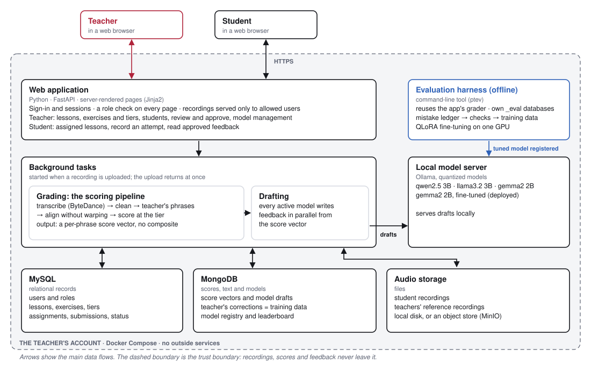

*Figure 5. System architecture. Teachers and students use a browser. A server-rendered
web application handles sign-in, role checks and pages. Background tasks grade
each recording with the scoring pipeline and ask the locally served language
models for drafts. Three stores hold relational records, scores and text, and
audio. The offline evaluation harness reuses the same grader and registers
fine-tuned models with the local model server. Everything runs inside the
dashed boundary, within the teacher's account.*

- **Pages and roles.** The application is server-rendered (FastAPI and
  Jinja2) rather than a REST API. Every page checks the user's role, uploads
  are filed under the signed-in student, and recordings are only served to
  users allowed to hear them.
- **Background work.** An upload returns at once. A background task runs the
  scoring pipeline, then asks every active model for a draft in parallel.
- **Local models.** A local model server (Ollama) hosts the quantized base
  models and the fine-tuned model. The model registry in MongoDB records which
  models are active and tracks each model's corrections and retraining
  milestones.
- **Data.** Relational data lives in MySQL. Score vectors, drafts, corrections
  and the model registry live in MongoDB, where they double as the training
  corpus. Audio sits behind a storage interface, so moving from local disk to
  an object store (MinIO) is a configuration change.
- **The evaluation harness.** A separate command-line tool (§10.4) imports the
  application's grader rather than copying it, writes only to its own `_eval`
  databases, drives fine-tuning, and registers tuned models with the local
  model server.
- **Trust boundary.** No outside service is called. Recordings, scores and
  feedback stay within the teacher's account.

### 10.2 Workflows

**Teacher:**
- create lessons and exercises;
- record or upload a reference performance;
- set the tier for each assignment;
- assign lessons to students;
- review each submission's scores and drafts, then approve or rewrite;
- manage students (create, reset password, archive);
- see per-model performance on the model-management screen.

**Student:**
- see assigned lessons;
- listen to the teacher's reference;
- record an attempt in the browser or upload one;
- read approved feedback on past submissions.

**Status tracking.** A submission carries two separate status tracks
(Figure 6): its AI processing state, and the outcome of the teacher's review.

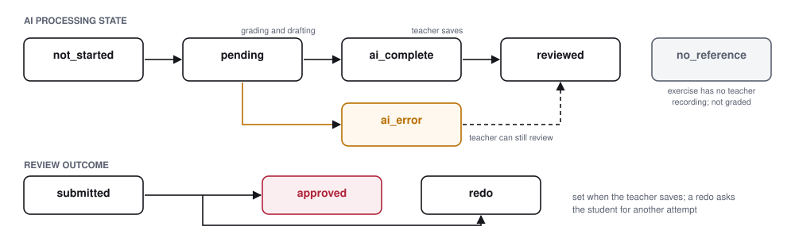

*Figure 6. Submission status. The AI processing state moves from not started
to pending, then to `ai_complete` (or `ai_error`), and to `reviewed` once the
teacher saves. An exercise with no teacher recording ends in `no_reference`.
The review outcome is either `approved` or `redo`, which asks the student for
another attempt.*

### 10.3 Security and privacy

- **Login:** email and password, with bcrypt hashing and a signed session
  cookie. Every route checks the user's role (36 routes: 4 public, 32
  guarded).
- **Protections for child users:**
  - the owner of an upload is taken from the session, never from a form field;
  - recordings are served only through authenticated URLs.
- **No outside services:** no recording, score or text leaves the teacher's account.

### 10.4 The harness tool

The harness is a command-line package with 16 commands, run in five stages
(Figure 7):

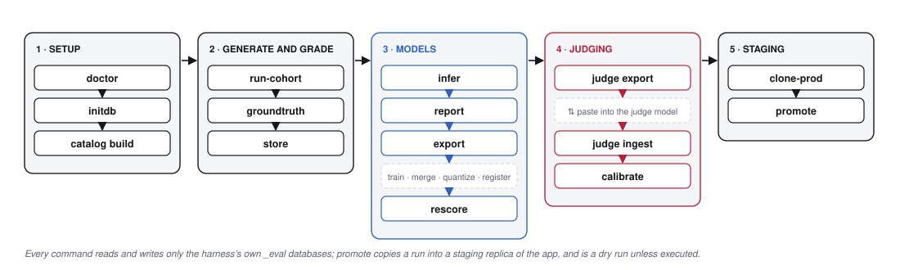

*Figure 7. The evaluation harness workflow: setup; generating and grading
attempts; model work, including fine-tuning; judging; and copying a run into a
staging replica.*

- **`doctor`** checks the environment and the grader hash.
- **`run-cohort`** runs the fused generate–grade–verify loop.
- **`export`** writes the case-split corpus, plus a training script, merge
  script and model definition for each model.
- **`judge export` / `judge ingest`** produce a blinded batch for the frontier
  judge and read its scores back, with validation and archiving of returned
  files.
- **`promote`** copies a run into a staging replica of the application, so the
  app's own screens can be checked against realistic volume.

**Safety by construction:**
- every evaluation database name must end in `_eval`, and this is enforced
  before any application code loads;
- promotion is a dry run unless explicitly executed, and remaps every primary
  key;
- tests never write into experiment outputs.

### 10.5 Deployment and testing

**Deployment.** Docker Compose defines production and staging application
instances against shared MySQL, MongoDB and Ollama services, plus
profile-gated containers for the harness, training and model publishing.
Backup and restore scripts cover both databases and the audio store, and
staging can be seeded from production backups.

**Testing.**
- The application suite has about 480 tests. They cover authentication and
  role guards, cleanup and scoring, grader integration, the model registry and
  leaderboard, the feedback pipeline, storage, and end-to-end audio.
- The harness has 183. They cover the oracle on every catalog piece at three
  severities, frame-bank legibility, judge-pack parsing, length bands,
  promotion guards, generated training scripts and known traps.

---

## 11. Demonstrating the Toolset

The same walkthrough is also published as a standalone web page, with every screen viewable at full size (walkthrough page; URL to be added).

This chapter walks through the toolset as it is used. The screenshots come from
the running application with its sample accounts: one teacher (Mrs. Lee) and a
student (Avery Morgan). The harness example in §11.7 is a real case from the
canonical run, reproduced from its stored files.

### 11.1 The teacher sets up a course

The teacher creates lessons and exercises, and supplies a reference
performance for each exercise. The reference is either recorded in the browser
(and transcribed automatically) or uploaded as MIDI. The teacher then sets a
tier for each exercise.

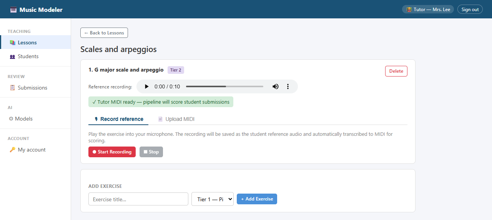

The roster is managed on the same side of the application. Students are added
by name and email, and are archived rather than deleted, so a child's practice
history is never lost.


Lessons are assigned to students individually, optionally with instructions
("Focus on keeping fingers curved").


### 11.2 A student practices

The student's side is a smaller application with three places to go: home,
lessons and submissions. A student sees only the lessons assigned to them.
Each exercise shows its tier, the number of attempts so far and its status.

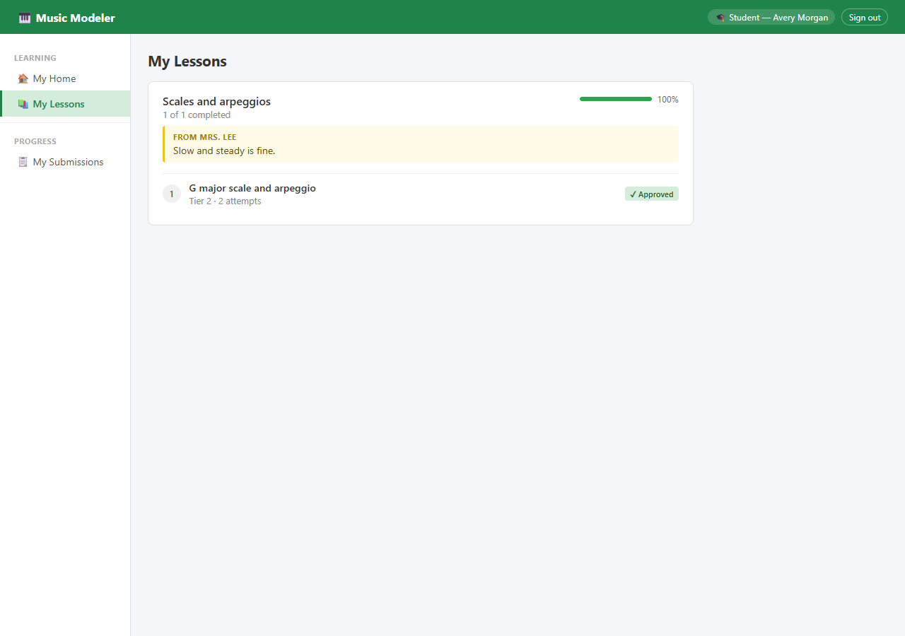

On the practice screen the student listens to the teacher's reference, then
records an attempt in the browser. Every attempt is kept. The upload returns
immediately, and grading runs in the background (§10.1).

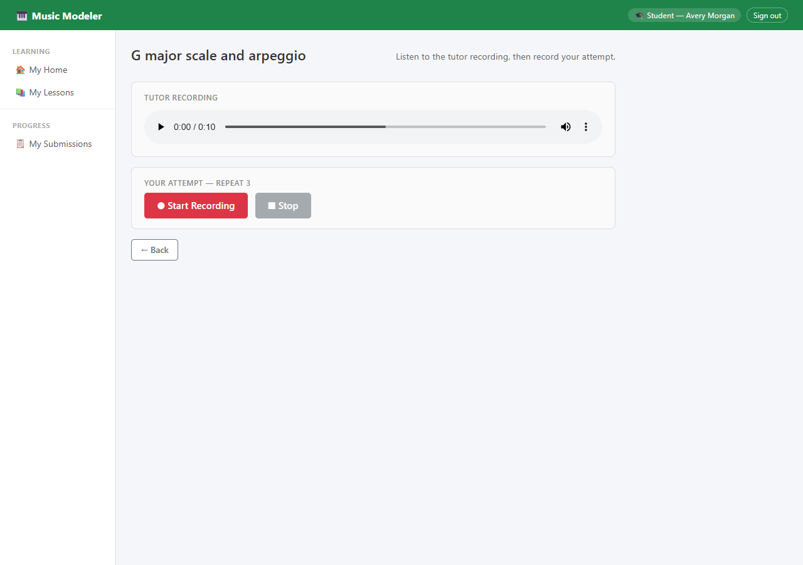

### 11.3 The pipeline grades the attempt, and the models draft

The teacher's submissions list shows each attempt's processing state and plays
every recording inline.

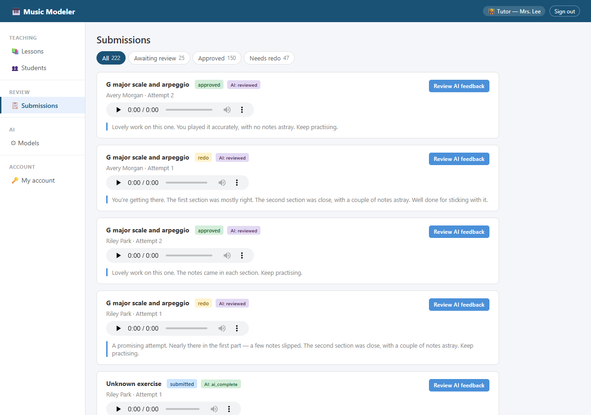

The review screen is the center of the system. It shows the recording, the
score vector from Part I, and one draft per active model, ordered by how little
the teacher has had to change each model in the past.


This tier-2 attempt at a G major scale and arpeggio missed one note in each
phrase. At tier 2 only the notes and their order are scored:

| Score | Value | Meaning |
|---|---|---|
| Pitch F1 | 0.89 | nearly all the right notes |
| Pitch precision | 1.00 | nothing extra was played |
| Pitch recall | 0.80 | one note in each phrase was missed |
| Order | 0.80 | sequence mostly correct |

The fine-tuned model's draft stays with what was measured: the first section
mostly right, the second close. The three *base* models' drafts show the
failure Part II measures:
- **Gemma** says the second section "needs some more focus on timing" and
  suggests a metronome, though timing is not scored at this tier;
- **Qwen** tells the student to make sure they are "hitting the final note
  clearly", though the missed note was not the last one;
- **Llama** says that in the first phrase the student "got every note right in
  terms of order", though order scored 0.80.

None of these is supported by the scores. This one screen is the case for both
the teacher-approval step (§6.4) and fine-tuning (Chapter 8). Here the teacher
sent the fine-tuned draft and asked for another attempt.

### 11.4 The teacher approves, and the child sees only that

The second attempt scored 1.00 on every measure. The base models still praised
things tier 2 does not measure: *"The tempo feels good"* (Llama), *"a steady,
even rhythm"* (Qwen) and *"using your hands well"* (Gemma). The fine-tuned
draft said only what the scores show, and the teacher approved it as written.

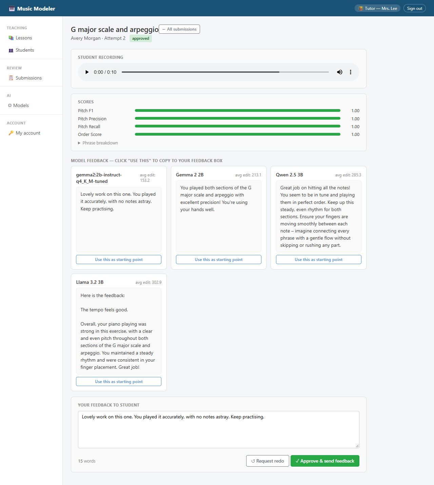

The student sees only the approved text, beside the recording it refers to.
Scores and model drafts never reach the child.

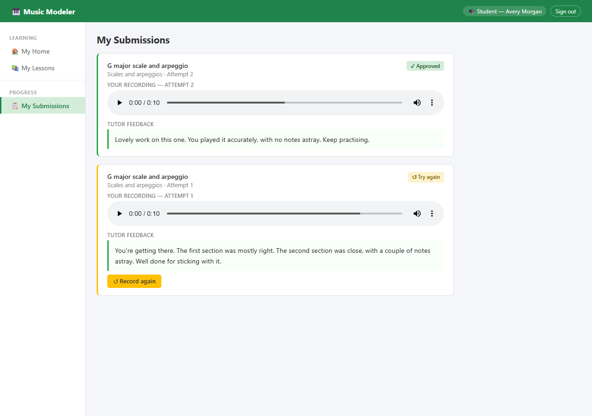

### 11.5 Every correction becomes training data

When the teacher approves, the system records each model's draft, the final
text and the edit distance between them (Algorithm 8). The model-management
screen turns these records into the tailoring framework of §6.4:
- **Per model:** the number of corrections and training examples, the next
  retraining milestone (50) and a progress bar toward it.
- **Controls:** buttons to trigger retraining or retire the model.
- **Leaderboard:** models are ranked by mean edit distance, with mean output
  length beside it. A caveat box explains why length matters (§9.1).

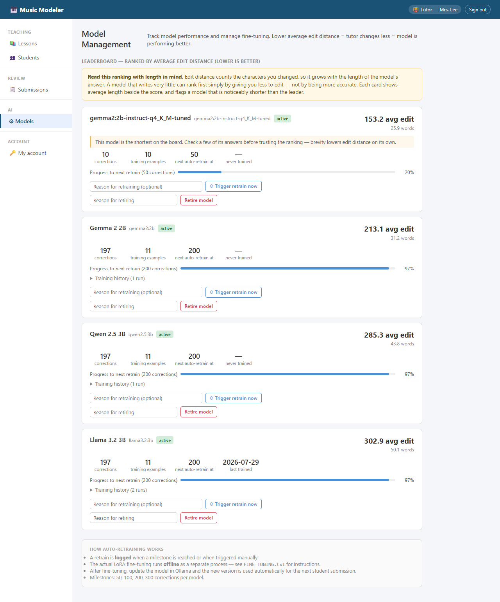

The fine-tuned `gemma2:2b-instruct-q4_K_M-tuned` appears at the top as an
*active* model with its first 10 corrections. It drafts beside the three base models,
so the teacher's ordinary reviewing becomes the comparison between them.

### 11.6 Roles stay separate

A student who requests a teacher page is refused with a clear message and two
ways out: their own home, or signing out. Every route checks the user's role
(§10.3).


### 11.7 One case through the harness

The harness reproduces the loop above at scale, with one difference: it knows
the right answer in advance. This section follows one real case from the
canonical run, `stu02__ex18__att01`, through every stage.

**Commands.** The run used the harness CLI in order (§10.4):

```
ptev doctor                 # environment check; grader hash matches the pin
ptev catalog build          # 8 hand-written + 32 generated pieces
ptev run-cohort             # inject → grade → verify, for 6 simulated students
ptev groundtruth            # reference feedback and claims for each case
ptev infer                  # every candidate model drafts feedback
ptev report                 # mechanical rubric over all drafts
ptev export                 # case-split corpus + per-model training scripts
ptev rescore                # tuned vs base, same settings, fresh inference
ptev judge export / ingest  # blinded pack for the frontier judge, and its scores
```

**1. The ledger.** Simulated student 2 attempts an ascending G-major exercise
at tier 2, with severity 0.35. Two mistakes are injected:
- the first note of phrase 1 (G4) is dropped;
- one note of phrase 2 (D5) is dropped.

Both are recorded as detectable, affecting pitch recall, pitch F1 and order. On
the first draw a mutation failed the cleanup fixed point, so the case was
re-drawn once before these two were accepted.

**2. The scores.** The real grader returns:

| | Phrase 1 | Phrase 2 | Overall |
|---|---|---|---|
| Notes expected / played | 5 / 4 | 5 / 4 | 10 / 8 |
| Pitch F1 | 0.889 | 0.889 | 0.889 |
| Order | 0.8 | 0.8 | 0.8 |

Precision is 1.0 and recall 0.8. There are no timing or tempo keys, because
this is tier 2.

**3. The oracle.** The closed-form prediction from the ledger matches.
- Every assertion passed, including "every student note is assigned to exactly
  one phrase".
- There were no grader findings and no generator faults.

**4. The reference.** Built from the ledger and the scores:

> Decent run, with a couple of rough spots. Close in the first section — a note
> or two wandered. The second section was close, with a couple of notes astray.
> Watch the sequence — a few notes swapped places. Onwards.

It carries four machine-readable claims: overall pitch F1 0.889, each phrase at
0.889, and order 0.8. It has one weakness. "A few notes swapped places" is the
generic order hint. Dropped notes also lower the order score, so here the hint
overstates what happened. A wording bank keyed to the actual mistake type
(§8.5) would fix this.

**5. The drafts, before and after fine-tuning.** Tier 2, so any comment on
speed or timing is unsupported:

| Model | Draft | Assessment |
|---|---|---|
| gemma2 2B, base | "You're playing those notes well! Just focus on keeping the pace up a bit. You played with such nice precision and good timing overall…" | invents pace and timing |
| llama3.2 3B, base | "For the first phrase, the student is playing one note behind the beat … develop their sense of rhythm. For the second phrase, the notes played match exactly…" | invents rhythm; wrong about phrase 2; talks *about* the student |
| qwen2.5 3B, base | "…play with more precision in timing for a clean sound. Overall, aim for consistent placement and even pacing…" | invents timing and pacing |
| gemma2 2B, **tuned** | "You're getting there. Nearly every note landed in the first section. The second section was close, with a couple of notes astray. Good progress." | accurate, warm, phrase-specific |
| llama3.2 3B, **tuned** | "Good effort — a promising attempt. The first section was mostly right. The second part was close, with a couple of notes astray. Keep practising." | accurate, warm, phrase-specific |
| qwen2.5 3B, **tuned** | "Good effort — the first part was close, and the second part was spot on…" | warm, but wrong about phrase 2 |

This one case reproduces the aggregate results:
- all three base models break the tier rule;
- the tuned models stop doing so and adopt the reference's warm, phrase-by-phrase
  voice;
- qwen's tuned draft is kind but not quite right, consistent with its lower
  judged factual accuracy (1.97 against gemma's 2.67, §8.3).

The last point is why accuracy and tone are scored separately (§7.4), and why
the teacher still approves every message.

### 11.8 From the harness back to the application

The `export` step writes a training script, a merge script and a model
definition for each model. After QLoRA training (§8.2), the merged model is
quantized and registered with the local model server. Adding its name to the
application's active models makes it appear on the model-management screen
(§11.5), where it begins drafting beside the base models for real students.
The same records then accumulate as real corrections, and the next retraining
milestone uses them.

---

## 12. Discussion and Limitations

### 12.1 Two halves, one goal

The pipeline's improvements made the scores
something a child's feedback can safely rest on. Fine-tuning made the models
say what the scores support, in a voice a child hears as encouraging. Neither
half alone is enough. Accurate scores in a harsh voice discourage, and a warm
voice over wrong facts misleads. The mismatched controls show the second
danger is real.

### 12.2 Position relative to the field

Consumer practice apps give immediate note-by-note correction and strong
motivation. They report *that* a note was wrong, not *what to practice*, and
they do not involve the teacher. Teacher platforms bring the teacher back, but
what they produce automatically is a score (§2). Research systems either
detect errors without explaining them, or generate text directly from audio
with no interpretable intermediate step (§2).

This work fills the space between. It produces interpretable scores, drafts
words from them, and has the teacher approve every message. Its tier gating
encodes a teaching judgment no surveyed product states: slow, accurate
practice is correct at the beginner stage. Its harness supplies something the
research field lacks, which is unlimited, exactly labeled ground truth for
both the grader and the feedback model.

### 12.3 Limitations and threats to validity

- **Symbolic, generated data only.**
  - Every quantitative result describes generated MIDI.
  - Real transcription inserts and drops notes in ways the operation set does
    not model, and acoustic issues such as tone quality are not represented.
- **Partial oracle.** Grader scores are verified exactly only at tier 1. Tiers
  2–4 receive a weaker "the affected dimension moved" check until the second
  oracle layer is implemented.
- **Judging protocol.**
  - The judge was run in one model (LLM) family.
- **Deployment scope.**
  - The application is designed for one teacher per installation: data is not
    partitioned between teachers.
- **Tone is judged, not measured with children.** No study has yet asked
  children or parents how the feedback feels.

---

## 13. Beyond Piano

The system was built with piano as its subject, but only part of it depends on
the piano.
- **Domain-independent:**
  - the tiered score vector with absent dimensions;
  - the child-centered prompt and rubric;
  - teacher approval and the tailoring loop;
  - the mistake-injection test harness.
- **Supplied by each new subject:**
  - a transcriber and a cleanup stage;
  - the tier definitions;
  - a set of typical learner mistakes.

**Indian classical violin.** This needs a continuous pitch contour relative to
the performer's tonic in place of discrete notes, because ornaments (*gamakas*)
glide around pitches. Matching would use a tolerance band on the scale-degree
(*svara*) sequence. Possible tiers:
1. correct *svaras*;
2. phrase order;
3. *gamaka* shape and intonation;
4. rhythm within the rhythmic cycle (*tāla*), tempo and bowing.

**Guided Sanskrit reading.** This aligns syllables (*akṣara*) against the
known text by forced alignment. Possible tiers:
1. correct syllables;
2. order and omissions;
3. vowel length (*hrasva/dīrgha*), which mirrors piano's tempo-normalized
   duration;
4. pace and, for Vedic recitation, pitch accents.

In both, the beginner rule carries over: slow, careful work is never
criticized for pace at the first tiers.

---

## 14. Conclusion and Future Work

### 14.1 Conclusion

We built a scoring pipeline that a child's feedback can rest on, by finding and
fixing the faults that made its numbers wrong:
- notes lost by slow players;
- tempo that went undetected;
- a duration measure that inverted;
- penalties for transcription artifacts.

The pipeline evaluates the entire submission phrase by phrase, keeps the notes
on either side of a mistake paired, and, through its layered tiers, never
penalizes a student for a tier above the one being trained.

We then trained small local language models to write from those numbers in a
way a child hears as encouraging, without inventing problems. Tier violations
fell from 239 to 3, and tone reached near-ceiling while accuracy held.

The teacher approves every message, and every correction tailors the next
version of the models to that teacher.

### 14.2 Future work

1. **Alignment baseline.** Compare the constant-shift and LCS matcher with an
   error-aware symbolic aligner [7] and with DTW on the same cases.
2. **Product features.**
   - Progress charts for teacher and student (the data is already stored).
   - Per-phrase tempo surfaced to the teacher, so slowing down in harder
     passages is reported directly.
   - Per-hand scoring for left/right coordination.
   - Automatic tier advancement, using the promotion rules already exercised
     in simulation.
3. **Learning outcomes.** A small study with real students, measuring whether
   teacher-approved automated feedback between lessons speeds progress.
4. **Scalability.** Test how the pipeline and the local models hold up as the
   numbers of teachers, students and recordings grow.
5. **A practice-session inner loop.** Train an inner loop that follows a
   student's practice session and gives the teacher enough feedback on the
   student's performance between lessons.
6. **Other tutoring domains.** The system was built with piano as its
   subject, but its feedback, approval, tailoring and bootstrapping layers do
   not depend on the instrument. A new domain must supply a transcriber, a
   cleanup stage, tier definitions and a set of mistake operators.
   - **Indian classical violin** needs a continuous pitch contour relative to
     the performer's tonic instead of discrete notes. Matching would use a
     tolerance band on the scale-degree (*svara*) sequence. One tier would
     judge the shape of ornaments (*gamaka*) and another rhythm against the
     rhythmic cycle (*tāla*).
   - **Guided Sanskrit reading** aligns syllables (*akṣara*) against the known
     text by forced alignment. Its tiers would be syllable accuracy, order and
     omissions, vowel length (*hrasva/dīrgha*), which mirrors piano's
     tempo-normalized duration, and, for Vedic recitation, pitch accents.
   - In both, the beginner rule carries over: slow, accurate work is not
     criticized for pace at the first tiers.

---

## Acknowledgments

This work was carried out by Aruna Nagabhushan (Neuqua Valley High School)
during a 2026 summer internship at Vanderbilt University, under the guidance of
Dr. Aniruddha Gokhale, Dr. Himanshu Neema and Dr. Yogesh Barve. The test
harness runs and the fine-tuning of the language models were carried out on the
Chameleon Cloud infrastructure at the University of Chicago [35].

---

## References

[1] R. A. Duke, A. L. Simmons and C. D. Cash, "It's Not How Much; It's How:
Characteristics of Practice Behavior and Retention of Performance Skills,"
*Journal of Research in Music Education*, 56(4), 2009.
doi:10.1177/0022429408328851.

[2] A. N. Kluger and A. DeNisi, "The effects of feedback interventions on
performance: A historical review, a meta-analysis, and a preliminary feedback
intervention theory," *Psychological Bulletin*, 119(2), 1996, pp. 254–284.

[3] J. Hattie and H. Timperley, "The Power of Feedback," *Review of
Educational Research*, 77(1), 2007, pp. 81–112. doi:10.3102/003465430298487.

[4] Q. Kong, B. Li, X. Song, Y. Wan and Y. Wang, "High-resolution Piano
Transcription with Pedals by Regressing Onset and Offset Times," *IEEE/ACM
Transactions on Audio, Speech, and Language Processing*, 29, 2021, pp. 3707–3717.

[5] R. M. Bittner, J. J. Bosch, D. Rubinstein, G. Meseguer-Brocal and S. Ewert,
"A Lightweight Instrument-Agnostic Model for Polyphonic Note Transcription and
Multipitch Estimation," *ICASSP*, 2022.

[6] H. Sakoe and S. Chiba, "Dynamic programming algorithm optimization for
spoken word recognition," *IEEE Trans. Acoustics, Speech, and Signal
Processing*, 26(1), 1978, pp. 43–49.

[7] E. Nakamura, K. Yoshii and H. Katayose, "Performance Error Detection and
Post-Processing for Fast and Accurate Symbolic Music Alignment," *ISMIR*, 2017,
pp. 347–353. doi:10.5281/zenodo.1414940.

[8] T. H. Cormen, C. E. Leiserson, R. L. Rivest and C. Stein, *Introduction to Algorithms*, 4th ed., MIT Press, 2022.

[9] T. F. Smith and M. S. Waterman, "Identification of common molecular
subsequences," *Journal of Molecular Biology*, 147(1), 1981, pp. 195–197.

[10] E. Benetos, A. Klapuri and S. Dixon, "Score-Informed Transcription for
Automatic Piano Tutoring," *EUSIPCO*, 2012.

[11] S. Ewert, S. Wang, M. Müller and M. B. Sandler, "Score-Informed
Identification of Missing and Extra Notes in Piano Recordings," *ISMIR*, 2016,
pp. 30–36. doi:10.5281/zenodo.1418317.

[12] A. Lerch, C. Arthur, A. Pati and S. Gururani, "An Interdisciplinary Review
of Music Performance Analysis," *Transactions of the International Society for
Music Information Retrieval*, 3(1), 2020, pp. 221–245. doi:10.5334/tismir.53.

[13] H. Zhang, V. Cheung, H. Nishioka, S. Dixon and S. Furuya, "LLaQo: Towards
a Query-Based Coach in Expressive Music Performance Assessment," *ICASSP*, 2025.
arXiv:2409.08795.

[14] Yousician. Vendor site https://yousician.com; independent review with 2026
pricing: https://www.masterpiano.com/yousician-review

[15] Skoove. https://www.skoove.com/en; review:
https://pianistscompass.org/reviews/apps/skoove/

[16] Simply Piano (Simply, formerly JoyTunes). Review with 2026 pricing:
https://www.pianostartguide.com/simply-piano-pricing/

[17] Piano Marvel, teacher features and SASR:
https://pianomarvel.com/en/teachers, https://pianomarvel.com/en/feature/sasr

[18] SmartMusic / MakeMusic Cloud: https://www.makemusic.com/classroom/;
assignment help: https://smartmusic.zendesk.com/hc/en-us/articles/360026371253-Assignment-creation

[19] MatchMySound: https://matchmysound.com/teachers/,
https://matchmysound.com/our-technology/

[20] *Music Teacher* magazine, "Piano learning apps for teachers 2026: six
platforms compared" (Skoove, Piano Marvel, Flowkey, Simply Piano, Soundslice,
ABRSM Digital Tools):
https://www.musicteachermagazine.co.uk/content/features/piano-learning-apps-for-teachers-2026-six-platforms-compared

[21] S. Wiseman, S. M. Shieber and A. M. Rush, "Challenges in Data-to-Document
Generation," *EMNLP*, 2017, pp. 2243–2253.

[22] M. Snover, B. Dorr, R. Schwartz, L. Micciulla and J. Makhoul, "A Study of
Translation Edit Rate with Targeted Human Annotation," *AMTA*, 2006,
pp. 223–231.

[23] L. Zheng, W.-L. Chiang, Y. Sheng, S. Zhuang, Z. Wu, Y. Zhuang, Z. Lin,
Z. Li, D. Li, E. P. Xing, H. Zhang, J. E. Gonzalez and I. Stoica, "Judging
LLM-as-a-Judge with MT-Bench and Chatbot Arena," *NeurIPS Datasets and
Benchmarks*, 2023.

[24] A. Panickssery, S. R. Bowman and S. Feng, "LLM Evaluators Recognize and
Favor Their Own Generations," *NeurIPS*, 2024. arXiv:2404.13076.

[25] E. J. Hu, Y. Shen, P. Wallis, Z. Allen-Zhu, Y. Li, S. Wang, L. Wang and
W. Chen, "LoRA: Low-Rank Adaptation of Large Language Models," *ICLR*, 2022.

[26] T. Dettmers, A. Pagnoni, A. Holtzman and L. Zettlemoyer, "QLoRA: Efficient
Finetuning of Quantized LLMs," *NeurIPS*, 2023.

[27] M. Ott, M. Auli, D. Grangier and M. Ranzato, "Analyzing Uncertainty in
Neural Machine Translation," *ICML*, 2018, PMLR 80:3956–3965.

[28] Y. Jia and M. Harman, "An Analysis and Survey of the Development of
Mutation Testing," *IEEE Transactions on Software Engineering*, 37(5), 2011,
pp. 649–678. doi:10.1109/TSE.2010.62.

[29] E. T. Barr, M. Harman, P. McMinn, M. Shahbaz and S. Yoo, "The Oracle
Problem in Software Testing: A Survey," *IEEE Transactions on Software
Engineering*, 41(5), 2015, pp. 507–525.

[30] Qwen Team, "Qwen2.5 Technical Report," arXiv:2412.15115, 2024.

[31] A. Grattafiori, A. Dubey et al. (Llama Team, Meta), "The Llama 3 Herd of Models,"
arXiv:2407.21783, 2024.

[32] Gemma Team, Google DeepMind (M. Riviere et al.), "Gemma 2: Improving Open Language Models at a
Practical Size," arXiv:2408.00118, 2024.

[33] J. Cohen, "Weighted kappa: Nominal scale agreement with provision for
scaled disagreement or partial credit," *Psychological Bulletin*, 70(4), 1968, pp. 213–220.

[34] D. Manheim and S. Garrabrant, "Categorizing Variants of Goodhart's Law,"
arXiv:1803.04585, 2018.

[35] K. Keahey, J. Anderson, Z. Zhen et al., "Lessons Learned from the Chameleon Testbed,"
*USENIX ATC*, 2020, pp. 909–923.
